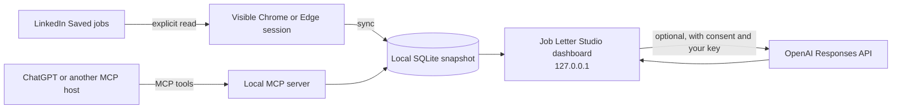

# LinkedIn Job Connector

<div align="center">
  <p><strong>Job Letter Studio · your local job-search workspace</strong></p>
  <p>Save opportunities. Understand the role. Prepare a cover letter you can review.</p>
  <p>
    
    
    
    
    
  </p>
</div>

> **Names:** Job Letter Studio is the dashboard brand; LinkedIn Job Connector is the repository and CLI name.

Read jobs you have manually saved on LinkedIn, keep a local SQLite snapshot,
and review jobs in the dashboard or through MCP. With your own OpenAI API key
and explicit consent, the dashboard can research opportunities and prepare
editable cover-letter drafts with PDF and Word versions.

> [!IMPORTANT]
> This app prepares and stores drafts; it does not submit applications. LinkedIn
> sign-in and security prompts stay manual, and the saved-jobs list refreshes
> only when you explicitly ask it to.

## At a glance

| Capture | Review | Prepare | Connect |
| --- | --- | --- | --- |
| Read your saved LinkedIn jobs through a dedicated, visible browser profile. | Keep a local SQLite snapshot with `NEW`, `PROCESSED`, and `IGNORED` states. | Review role and company research, edit letters, and archive PDF/DOCX versions. | Use MCP tools or save ChatGPT-prepared applications in the separate “Open AI” space. |

Automatic AI processing is optional. It queues imported or changed jobs only
after you configure your own API key and explicitly enable consent and
automation.

## Workflow at a glance



The MCP server reads the local snapshot; it does not open LinkedIn or refresh
the saved list during a tool call. ChatGPT's custom MCP connection needs a
remote route such as OpenAI Secure MCP Tunnel; the local server itself has no
HTTP port by default.

## Where your data goes

| Data | Handling |
| --- | --- |
| Jobs, CV, context, and letters | Stored in the local app data directory, which is ignored by Git. A cloud-sync service such as OneDrive may still sync that folder. |
| AI requests | When you enable processing, the app sends the selected job and candidate material needed for that request to OpenAI. |
| ChatGPT via MCP | Only the tool results requested by ChatGPT are sent to ChatGPT; review the profile and examples before connecting. |
| Applications | Drafts stay for your review. The app does not fill or submit applications. |

## Quick start

For Windows setup, follow [Setup on Windows](#setup-on-windows), then run these
commands from the project directory:

```powershell
.\.venv\Scripts\python.exe main.py
.\.venv\Scripts\python.exe main.py --sync-saved-jobs
.\.venv\Scripts\python.exe main.py --dashboard
```

Sign in only in the dedicated visible browser profile. Complete any CAPTCHA,
2FA, or security prompt yourself. The dashboard listens on `127.0.0.1` and uses
a free port assigned by the operating system at startup. Pass `--port <port>`
to select a fixed port; startup fails if that port is occupied. Keep
`browser_profile/`, `data/`, and local session files private; they are not files
to share or commit.

## Contents

- [Quick start](#quick-start)
- [Where your data goes](#where-your-data-goes)
- [Operating boundaries](#operating-boundaries)
- [Repository structure](#repository-structure)
- [Windows setup](#setup-on-windows)
- [User guide](docs/USER_GUIDE.md)
- [Local Laya guide](docs/LAYA_GUIDE.md)
- [Laya validation notes](docs/LAYA_VALIDATION.md)
- [MCP and ChatGPT guide](docs/MCP_CHATGPT_GUIDE.md)
- [Developer checks](#checks)
- [Project orientation prompt](#copy-and-paste-prompt-understand-this-project)

## Setup on Windows

```powershell
py -m venv .venv
.\.venv\Scripts\python.exe -m pip install -r requirements.txt
```

Google Chrome or Microsoft Edge must already be installed. The project uses a
dedicated browser profile, not your personal Chrome profile. Do not copy or
commit `browser_profile/`, `data/`, or any local session files.

## Repository structure

| Path | Contents |
| --- | --- |
| linkedin_connector/ | Browser reader, data models, SQLite store, dashboard server, and generation workflow |
| dashboard/ | Local dashboard HTML, CSS, and JavaScript |
| mcp_server/ | MCP tools backed by the local database |
| docs/ | User, Laya, MCP, and validation guides |
| tests/ | Reader, persistence, dashboard, and MCP test suite |
| data/ | Local database, profile files, CV, logs, and generated letters; ignored by Git |
| browser_profile/ | Dedicated Playwright browser session; ignored by Git |
| main.py | Authentication, read, sync, and dashboard commands |

## Operating boundaries

- Read only jobs you have saved yourself. The browser profile is dedicated and visible; complete sign-in, CAPTCHA, 2FA, and other security prompts manually.
- Refreshing LinkedIn is an explicit action. The full scan is capped at 100 jobs per pass; incomplete scans do not write a partial batch.
- The app prepares drafts and files for your review. It never fills or submits applications.
- OpenAI processing requires your API key and explicit consent. Review the in-app data-transfer notice before enabling it.
- Git ignores local data and browser files, but OneDrive or another sync service may still copy them.
- ChatGPT's custom MCP and scheduled-task support depends on the target workspace and available approvals. See the MCP and ChatGPT guide.

## Detailed guides

- [User guide](docs/USER_GUIDE.md) — authentication, reading and syncing jobs, dashboard workflows, cover letters, file archives, and logs.
- [Local Laya guide](docs/LAYA_GUIDE.md) — installation, current behavior, limits, and fallback.
- [Laya validation notes](docs/LAYA_VALIDATION.md) — dated measurements, methodology, and unverified real-world outcomes.
- [MCP and ChatGPT guide](docs/MCP_CHATGPT_GUIDE.md) — MCP tools, Secure MCP Tunnel setup, scheduled-task instructions, and data boundaries.

## Checks

```powershell
.\.venv\Scripts\python.exe -m compileall -q linkedin_connector mcp_server tests main.py
.\.venv\Scripts\python.exe -m unittest discover -v
```

## Copy-and-paste prompt: Understand this project

Use this prompt to ask an agent for a read-only orientation of the repository:

```text
You are preparing a read-only technical orientation of this repository for a new maintainer.

Read AGENTS.md, README.md, and the linked documentation in docs/: USER_GUIDE.md, LAYA_GUIDE.md, MCP_CHATGPT_GUIDE.md, and LAYA_VALIDATION.md. Then inspect only the source files relevant to the questions below, starting with:
- main.py
- linkedin_connector/reader.py, models.py, database.py, dashboard.py, generation.py, ai_provider.py, and profile.py
- dashboard/index.html, dashboard/app.js, and dashboard/styles.css
- mcp_server/server.py
- requirements.txt, requirements-laya.txt, and .gitignore

Do not read data/, browser_profile/, .venv/, local databases, CVs, logs, session files, credentials, or environment files. Do not modify or create files. Do not run tests, scripts, the application, or services; do not make network requests or contact external systems.

Explain the project overview, architecture, main user flows, data boundaries, and the role of the files you inspected. For every important claim, cite the repository path and line number(s). Separate:
1. Verified facts supported by the current source.
2. Inferences, with the reasoning and evidence stated.
3. Unknowns, limitations, or behavior you could not verify under these read-only constraints.

Treat source code as authoritative when it differs from documentation. Do not claim a test, live account, external service, or production behavior was verified.
```
